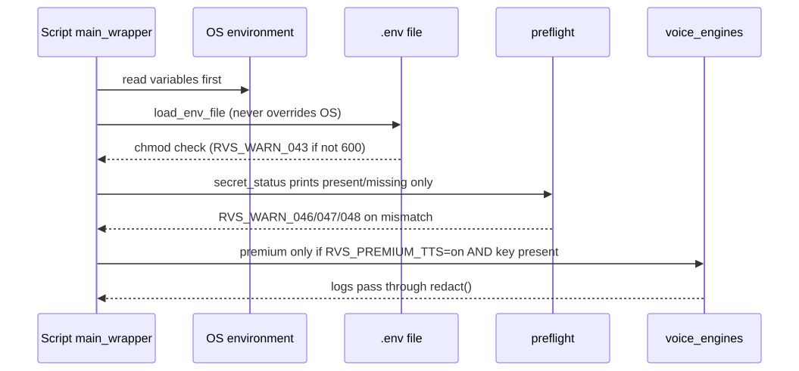

## Appendix Q — Visual Architecture (Mermaid, v5.1, addition H)
*(Drawn last from the final tables. Tables/sections stay the source of truth; each diagram names the section it mirrors. Max 25 nodes per diagram. Validated with `@mermaid-js/mermaid-cli` in the audit — result in Appendix N.5 / audit report.)*

**Q.1 System architecture & context** (mirrors §3, §7.1, Hard Rule 1, App H)

Legend: solid = data/control flow; dotted = shared helper/config; `(…)` = file store. Only `EDGE` and `EL` touch the network at runtime.

**Q.2 End-to-end pipeline** (mirrors §5.1 + gates)

Legend: rectangles = stages, diamonds = Operator gates; red-path labels are error codes (Appendix J).

**Q.3 Render paths** (mirrors §7.1 table)

Legend: edge labels = preflight conditions (G.1 `probe_environment`).

**Q.4 Repurpose engine** (mirrors §5.4, G.8)

Legend: `(…)` = files; body audio is never re-synthesised.

**Q.5 Skill router & dependency map** (mirrors App A.3 router, App P.3)

Legend: arrow = "uses"; dotted = cross-cutting support.

**Q.6 Error handling, retry & fallback** (mirrors §10, App J)

Legend: `RVS_ERR_*` fatal, `RVS_WARN_*` fail-soft; resume = rerun the same command (engine-keyed cache + scene cache).

**Q.7 Secrets & configuration load order** (mirrors App H)

Legend: no key value is ever printed, logged, put in prompts or written to files.

**Q.8 CI pipeline & eval flow** (mirrors App M, App N.4)

Legend: default CI uses recorded fixtures, no network, no keys.
